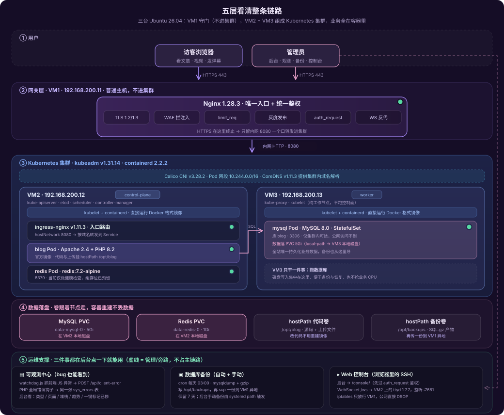

<div align="center">

</div>

<h1 align="center">杂鱼♥～杂鱼♥～连个博客都要人家帮你搭？</h1>

<h3 align="center">模糊二维码 · Ubuntu 版 ｜ Apache + PHP 8.2 + MySQL 8 + K8s 三机集群</h3>

<p align="center">
诶——连 LAMP 都装不利索吗？好可怜哦～<br>
人家这个可是自己手搓的：三台机器、五层链路、39 项技术栈，全都跑在线上哦。<br>
看不懂也没关系，人家会「慢慢」教你的♡
</p>

<div align="center">

</div>

<p align="center"><sub>「杂～鱼～♡ 居然还真点进来了，嘻嘻～」</sub></p>

<p align="center">
  
  
  
  
  
  
</p>

<p align="center">杂鱼♥ 杂鱼♥ ─── ♡ ─── 废柴♥ 废柴♥</p>

> [!NOTE]
> 语气很差是**故意的**（雌小鬼风味，角色扮演而已，不是真的在骂你）。
> 技术内容一条没少，赶时间的杂鱼请直接跳到 ❻ 抄命令，反正你也只看那一节吧♡

---

## ♡ ⓿ 先照照镜子，你是什么水平 (￣▽￣)

人家是**服务器版**：Apache + PHP 8.2 + MySQL 8，就是你们嘴里那套「LAMP」。
前端页面和隔壁那个弱弱的 [Windows 版](https://github.com/ipc-mdd-gl3-1545/blur-qr-blog-Windows) 一模一样——
只是后端换成了 PHP、数据搬进了 MySQL，所以人家能上 K8s、能每天定时备份，还能在后台里开出一个小终端。
……诶，这些词你听得懂吗？(￢_￢) 果然是废～柴～杂～鱼♡ 嘻嘻～

| 人家问你 | 老实回答 | 顺便说一句 |
| --- | --- | --- |
| 你叫什么 | 模糊二维码 · 博客服务器版（`blur-qr-blog-Ubuntu`） | 名字这么长，杂鱼记不住吧♡ |
| 你吃什么 | Apache 2.4 · PHP 8.2 · MySQL 8 · 可选 Redis 7.2 | 这几个你装过哪一个？一个都没有吧 |
| 你住哪 | 一台 Ubuntu（`/var/www/blog`），或者一整套 K8s 集群里 | 「集·群」两个字就把你吓到了？ |
| 你多重 | 零框架、零 npm、零构建，PHP 原生写的，源码打开就能读 | 比你的 `node_modules` 轻多了哦♡ |
| 你适合谁 | 想长期挂在服务器上、还想顺手学点运维的人 | 反正不是给只会双击的人用的 |
| 你脾气 | 外面只开一道 443 的门，数据库连公网的门都没有 | 你的 3306 现在是不是还裸奔着？ |

<p align="center">♡ ───── ♡ ───── ♡</p>

## ♡ 目录 · 只准看一节哦

| 章节 | 里面写了什么 | 看不看得懂 |
| :---: | --- | :---: |
| ⓿ | 你是什么水平 — 人家的自我介绍 | 应该能 |
| ❶ | 整条链路 — 三台机器五个层 | 大概不能 |
| ❷ | 技术栈 — 六组 39 项，一层不落 | 肯定不能 |
| ❸ | 它都会做什么 — 十六个本事 | 会用就行 |
| ❹ | 小影院 & 弹幕 — 自己的片子自己排 | 这个你行 |
| ❺ | 后台十一个页面 — 人家的小书房 | 只许看 |
| ❻ | 部署 — 一行命令装好，照着抄 | 求你了别乱改 |
| ❼ | 备份与恢复 — 每天凌晨偷偷存一份 | 早点学会 |
| ❽ | 日常运维 + 回滚 — 别把线上玩坏了 | 记下来 |
| ❾ | 文件都放在哪 — 目录树 | 找得到算你赢 |
| ❿ | 小问题急救箱 — 人家踩过的坑 | 你还会再踩一遍 |

---

## ♡ ❶ 三机五层，人家画给你看

<p align="center"><sub>♡ 就这点拓扑，杂鱼要盯多久才看得懂呀 ♡</sub></p>

```
访客 · 浏览器
    │  HTTPS 443（全网唯一的一道门）
    ▼
VM1 · Nginx 1.28.3 —— TLS / WAF / 限流 / 灰度 / 统一鉴权
    │  内网 :8080（只有 VM1 连得到）
    ▼
VM2 · ingress-nginx 1.11.3（hostNetwork，不写 host 的 catch-all）
    │
    ├── Service blog:80 ──▶ blog Pod（Apache 2.4 + PHP 8.2）
    │                          ├──▶ Service mysql:3306 ──▶ MySQL 8（PV 5Gi，住 VM3）
    │                          └──▶ Service redis:6379 ──▶ Redis 7.2（暂时只做探活）
    │
    ├── 旁路 · 观测   watchdog.js ──▶ sys_errors 表 ──▶ 后台「观测中心」
    ├── 旁路 · 备份   mysqldump + gzip ──▶ /opt/backups ──▶ scp 一份到 VM1
    └── 旁路 · 控制台 /console/ ──▶ WebSocket /ws ──▶ ttyd 1.7.7:7681
```

一句话：**外面只露一个 443 的门，门后全是内网；数据库连公网的门都没有。**
——学到了吗？别再把你那台机器的 3306 直接开到公网上了，真的很丢人 (￣▽￣)

<details open>
<summary><b>▸ 点开看完整架构图（五层 + 39 项技术栈 + 踩坑备忘）</b></summary>

<b>完整文字版：<a href="docs/ARCHITECTURE.md">docs/ARCHITECTURE.md</a></b>，矢量图如下：

<div align="center">

</div>

</details>

> [!TIP]
> 这张图和后台「架构图」页里的是同一份，改一处记得同步另一处。
> 图加载不出来的时候，`docs/ARCHITECTURE.md` 里还有一整套文字版——对，专门给你这种懒人准备的。

<p align="center">♡ ───── ♡ ───── ♡</p>

## ♡ ❷ 39 项技术栈，你能认出几个？

<p align="center"><sub>♡ 数完了吗？数不完就承认自己弱吧 ♡</sub></p>

### 2.1 网关入口 · VM1（8 项）

| 技术 | 在这个项目里干什么 |
| --- | --- |
| **Nginx 1.28.3** | 全站唯一入口，443 进来，内网 8080 出去 |
| **OpenSSL 自签 TLS** | 内网只跑 HTTP，证书的事只在门口解决一次 |
| **手写 WAF** | `location` 规则拦 SQL 注入、`../` 穿越这类请求 |
| **`limit_req` 限流** | 登录、发弹幕、上传各一档，防刷屏 |
| **`map` + `split_clients`** | 按比例灰度，新版本先接一小撮流量 |
| **`auth_request`** | 后台、`/console/`、`/ws` 共用一套登录态 |
| **WebSocket 反代** | `proxy_http_version 1.1` + `Upgrade`，控制台要长连接 |
| **ufw** | 只留 22 / 80 / 443 |

### 2.2 容器编排 · VM2 + VM3（9 项）

| 技术 | 版本 | 干的活 |
| --- | --- | --- |
| **Kubernetes** | v1.31.14 | 编排、调度、自愈 |
| **kubeadm** | — | 起集群的那把钥匙 |
| **kubelet / kube-proxy** | — | 每个节点上的手脚 |
| **containerd** | 2.2.2 | 真正跑容器的运行时（Docker 格式镜像也认） |
| **Calico CNI** | v3.28.2 | Pod 网段 `10.244.0.0/16` 跨节点互通 |
| **CoreDNS** | v1.11.3 | `blog`、`mysql` 这些名字靠它解析 |
| **ingress-nginx** | v1.11.3 | `hostNetwork` 监听 8080，按 path 转 Service |
| **Deployment / StatefulSet** | — | 无状态的用 Deployment，数据库用 StatefulSet |
| **ConfigMap** | — | 配置和镜像分开，改配置不用重建镜像 |

### 2.3 数据存储（5 项）

| 技术 | 形态 | 说明 |
| --- | --- | --- |
| **MySQL 8.0** | StatefulSet + PVC 5Gi | 全站唯一持久化的业务数据，住在 VM3 |
| **Redis 7.2-alpine** | Deployment + PVC 1Gi | 缓存位已经预留，**目前只被 `/healthz` 探活**，业务还没用上 |
| **local-path-provisioner** | v0.0.28 | 动态建 PV，卷落在 Pod 所在节点磁盘上 |
| **PVC / PV** | 5Gi + 1Gi | 数据库与缓存的持久卷 |
| **hostPath** | `/opt/blog` · `/opt/backups` | 源码和备份直接挂宿主目录，改文件立即生效 |

### 2.4 应用运行（6 项）

| 技术 | 说明 |
| --- | --- |
| **Apache 2.4** | rewrite 路由、deflate 压缩、headers 控制、敏感文件屏蔽 |
| **PHP 8.2** | 单入口路由 `api/index.php`，bootstrap 统一引导 |
| **原生 PHP API** | 不引任何框架，`api/admin.php` 一个文件写完后台接口 |
| **Markdown 渲染** | 文章正文的前端轻量渲染，支持标题/列表/代码/图片/引用 |
| **bcrypt** | 后台口令哈希，密码不落明文 |
| **PDO 预处理** | 所有 SQL 走占位符，防注入 |

### 2.5 运维工具（8 项）

| 技术 | 说明 |
| --- | --- |
| **systemd** | Apache/MySQL 开机自启；备份按钮走 `.path` 单元监听文件变化 |
| **cron** | 监控每 10 秒采一个点（`for` 循环 + `sleep` 凑秒级） |
| **mysqldump + gzip** | 每天 03:00 导出 `blog_YYYYMMDD_HHMMSS.sql.gz`，保留 7 天 |
| **scp** | 备份再异地存一份到 VM1，机器炸了也还在 |
| **ttyd 1.7.7** | 浏览器里的终端，`iptables` 只放行 VM1 |
| **iptables** | 7681 端口白名单，公网直接 DROP |
| **`sys_errors` 表** | 前端 JS 报错 + PHP 报错都收进同一张表 |
| **`watchdog.js`** | 前端探针，`POST /api/client-error` 把异常送回来 |

### 2.6 系统底座（3 项）

| 技术 | 说明 |
| --- | --- |
| **Ubuntu 26.04.1 LTS ×3** | VM1 网关 / VM2 控制面 + 干活 / VM3 worker 专心跑数据 |
| **VMware 虚拟机** | 三台机器都在一台物理机上，内网 `192.168.200.0/24` |
| **Pod 网段 `10.244.0.0/16`** | Calico 分配的容器网段，和宿主机网段互不打扰 |

<p align="center">♡ ───── ♡ ───── ♡</p>

## ♡ ❸ 人家会的东西，你一样都不会

<p align="center"><sub>♡ 十六个，全都是真的在线上跑着的哦 ♡</sub></p>

| 小家伙 | 会做的事 | 人家的话 |
| --- | --- | --- |
| 首页 | 全屏视频背景 + 打字机标题 + 呼吸感玻璃卡片 | 你那个模板站有吗？ |
| 六个方向 | 前端 / 后端 / SRE / AI Agent / 数据库 / 计算机网络，各是独立页面 | 学习路线和思维导图都画好了，白送你的 |
| 文章列表 | 卡片只留「封面 + 标题」，点一下跳去正文 | 清爽吧？不像你的首页塞满广告 |
| 文章详情 | 小标题 / 列表 / 引用 / 粗体 / 行内代码 / 图片，点图放大，Esc 关掉 | 嗯，这个你大概也能抄（笑） |
| 图片上传 | 上传前在浏览器里先压一压（长边 1920），带百分比和速度进度条 | 你的图是不是传一张就超时？ |
| 小影院 | 播放本机目录里的视频，自动生成播放列表 | 自己的片子自己排♡ |
| 弹幕 | 游客也能发，彩色、透明度可调、网页全屏、发送限速 | 你连弹幕都不会做吧 |
| 数据库页 | 看表结构、翻数据、导 CSV、下载整库快照、只读 SQL | 不用登服务器了，开心吗 |
| 日志 | 登录 / 发布 / 上传 / 报错全记下来，能筛能搜能下载 | 出事只会重启的人有福了 |
| 观测中心 | 前端 JS 报错 + PHP 报错都收进 `sys_errors`，能看到哪个页面哪一行 | 连 bug 在哪都不知道的杂鱼♡ |
| 架构图 | 后台里就能看整条链路，还带几个健康灯 | 图都不会看就别装运维了 |
| 备份管理 | 点一下立刻备份，能下载、能看上次结果 | 等到删库了才想起来？ |
| SSH 控制台 | 浏览器里的终端（ttyd + WebSocket），只有登录的人能开 | 双保险的，别想着乱碰 |
| 阅读数 | 每次打开正文悄悄 +1 | 有人来看就好（虽然大概率是你自己） |
| 性能 | gzip、ETag/304、视频 Range 拖动、静态缓存 | 小机器也飞快，惊不惊喜 |
| 安全 | bcrypt 口令、HMAC 会话、登录限速、CSP、源码与数据库全屏蔽 | 门锁好了，砸门的进不来 |

<div align="center">

</div>

<p align="center"><sub>「杂～鱼～杂～鱼～ 真是没用～♡」</sub></p>

<p align="center">♡ ───── ♡ ───── ♡</p>

## ♡ ❹ 小影院 & 弹幕 · 这个你总该会用了吧

<p align="center"><sub>♡ 首页往下滑，有个只属于人家的放映厅 ♡</sub></p>

视频放在这台机器的 `VIDEO_DIR` 目录里（默认 `/var/www/blog/videos`），由 Apache 直出、**秒开、随便拖进度条**，游客还能发弹幕。

一个配置就能开张——看好了，只写一遍：

```php
// api/config.php
'VIDEO_DIR' => '/var/www/blog/videos',   // 视频目录，换路径只改这一行
```

把 `mp4` 丢进去，`chown www-data:www-data`，刷新首页就有播放列表了。就这么简单，还是说这也要人家帮你？

- **怎么传视频**：后台左侧点「▷ 小影院」，再点「上传视频」或直接把文件拖进去，带百分比和速度进度条；列表里能播放、能删除（删视频会顺手清掉它的弹幕）
- **为什么不用网盘**：试过 AList 接阿里云盘，第三方拉流只有 96 KB/s，而局域网是 20 MB/s 以上——差 200 倍，1080p 喂不动。别再问「为什么不用网盘」了，问就是你自己去试
- **只放这个目录**：`VIDEO_DIR` 之外的文件访问会被拒，`../` 穿越也会被拦掉
- **格式**：浏览器能直接播的是 `mp4`(H.264) 和 `webm`，`mkv`/`avi` 这类先转码
- **弹幕存在哪**：和文章同一个 MySQL，走了索引，几万条也不慌
- **防刷屏**：同一 IP 默认 3 秒一条、单条最多 50 字（`DANMAKU_COOLDOWN_SEC` / `DANMAKU_MAX_LEN` 可调）

> [!WARNING]
> 上传视频报 `413 Request Entity Too Large` 了吧？噗。
> **Nginx、Ingress、PHP 三层的默认上限分别是 1M / 1M / 8M**，三层都要抬到 1024M，
> 只改一层是没用的哦——这种基础到不行的东西，人家还以为你会呢 (￣▽￣)

<p align="center">♡ ───── ♡ ───── ♡</p>

## ♡ ❺ 后台十一个页面 · 人家的书房，你只许看

<p align="center"><sub>♡ 入口藏在 ADMIN_PATH，猜不到就进不来哦 ♡</sub></p>

| 页面 | 能做的事 |
| :---: | --- |
| ▤ 概览 | 文章数、已发布、草稿、总阅读、图片与视频占用、弹幕数 |
| ✎ 文章 | 新建 / 编辑 / 删除、Markdown 正文、封面上传、草稿与发布 |
| ▷ 小影院 | 上传视频、列出目录里的文件、删除、看单个大小 |
| ✺ 弹幕 | 按视频分组查看、搜索、单条删除、清空某个视频 / 清空全部、清理孤立弹幕 |
| ▦ 数据库 | 表结构与体积、分页浏览、关键词搜、导 CSV、下载整库快照、只读查询 |
| ≡ 日志 | 实时列表、按级别与类别筛选、搜索、下载日志文件 |
| ◔ 观测中心 | 前端报错 + PHP 报错，按类型 / 页面 / 堆栈查看，可标记已修 |
| ◈ 架构图 | 整条链路图 + 健康灯，改图记得同步 `docs/architecture.svg` |
| ▣ 备份管理 | 立即备份、下载、恢复演练、看上次备份结果 |
| ⌘ SSH 控制台 | 浏览器里的终端，`auth_request` 先拦一道，`iptables` 再拦一道 |
| ⚙ 设置 | 改后台密码（校验旧密码，改完立即生效） |

> [!NOTE]
> 后台**不是** `/admin.html` 哦（那个被 Apache 直接拒绝访问，别试了）。
> 真正的入口是 `api/config.php` 里 `ADMIN_PATH` 指定的路径，默认 `/manage`。
> 想改？配置文件和 `apache-vhost.conf` 的 rewrite 要一起改——少改一个就 404，到时候别来哭。

<p align="center">♡ ───── ♡ ───── ♡</p>

## ♡ ❻ 部署 · 照着抄，别自己发挥

<p align="center"><sub>♡ 一行命令，Apache、MySQL、PHP、建库、密码、rewrite 全给你安排好 ♡</sub></p>

### 6.1 一键安装（唯一的推荐做法）

```bash
# 1. 把项目克隆到网站根目录
sudo mkdir -p /var/www/blog
sudo git clone https://github.com/ipc-mdd-gl3-1545/blur-qr-blog-Ubuntu.git /var/www/blog
cd /var/www/blog

# 2. 一键安装（Ubuntu 22.04 / 24.04 / 26.04 都可以）
sudo bash deploy/lamp/install.sh
```

脚本会乖乖做完 7 件事，你只要坐着等：

1. 装 Apache / MySQL / PHP（含 `php-mysql`、`php-mbstring`、`php-xml`、`php-curl`）
2. 生成随机数据库密码，建库 `blog`、建用户 `blog`、导入 `init.sql` 建表
3. 生成 `api/config.php`：随机后台密码、随机会话密钥，权限 `600`
4. 目录归属 `www-data`，`data/`、`uploads/`、`videos/` 建好
5. 配 Apache：`rewrite`、`headers`、`deflate` 三个模块 + `blog.conf` 虚拟主机
6. 把 PHP 上传上限抬到 4096M，再往 `/etc/crontab` 加一条每 10 秒的监控采样
7. 重启并开机自启 MySQL、Apache

> [!CAUTION]
> 装完会打印几行小纸条，**后台初始密码只显示这一次**，记得抄下来！
> 弄丢了就自己改配置去吧，人家可不会帮你找回♡

```
网站地址     http://你的IP/
后台地址     http://你的IP/manage
后台初始密码 xxxxxxxx        ← 只显示这一次，务必保存
数据库       blog / blog
数据库密码   xxxxxxxx        ← 已写进 api/config.php
视频放到     /var/www/blog/videos
日志文件     /var/www/blog/data/blog.log
```

### 6.2 已经有一套 K8s 集群？（那还行，勉强算你有点水平）

把 `deploy/lamp/` 里的 `apache-vhost.conf` 当成容器里的 vhost 用，代码走 hostPath 挂进 Pod，
再照 `docs/ARCHITECTURE.md` 里的 Service / Ingress 名字接上——
`blog:80`、`mysql:3306`、`redis:6379` 三个名字对上，整条链路就通了。

> [!TIP]
> 别忘了 `ingress-nginx` 要用 `hostNetwork` 监听 8080，
> 而且 Ingress 的 `host` 字段**只认域名不认 IP**，写 IP 会直接报 `must be a DNS name`。
> 所以用一条不写 host 的 catch-all 兜住，顺手也支持了「IP 直接访问」。
> ——这个坑人家踩过了，你就别再踩一遍，很浪费时间的。

### 6.3 部署完自己验一下，别急着说「好了」

```bash
curl -s http://127.0.0.1/healthz                          # 应返回 ok
curl -s -o /dev/null -w '%{http_code}\n' http://127.0.0.1/ # 200
curl -s -o /dev/null -w '%{http_code}\n' http://127.0.0.1/manage  # 200
systemctl status apache2 mysql --no-pager | head -20       # 两个服务都要 active
tail -n 20 /var/www/blog/data/blog.log                     # 看看它有没有偷偷报错
```

四条全是好消息，才算真的活了。有一条不对就回去看 ❿，别装作没看见。

<p align="center">♡ ───── ♡ ───── ♡</p>

## ♡ ❼ 备份 · 等删库了才想起来就晚了

<p align="center"><sub>♡ 数据全在 MySQL 里，这个你要是也不做，那真的没救了 ♡</sub></p>

**后台点一下**：后台 →「▣ 备份管理」→ 立即备份。
按钮背后是 systemd `.path` 单元触发的一次 `mysqldump`，生成 `blog_YYYYMMDD_HHMMSS.sql.gz`，可下载、可删除。

**每天凌晨自动备（cron 03:00）**：

```bash
mysqldump -u blog -p blog | gzip > /opt/backups/mysql/blog_$(date +%F_%H%M%S).sql.gz
# 再异地存一份到 VM1，机器炸了也还在
scp /opt/backups/mysql/blog_*.sql.gz root@192.168.200.11:/opt/backups/mysql/
```

保留 7 天，脚本会自己删更早的。

**恢复**（会覆盖当前数据，先停 Apache 再动手，别手快）：

```bash
sudo systemctl stop apache2
gunzip < /opt/backups/mysql/blog-20261124-030000.sql.gz | mysql -u blog -p blog
sudo systemctl start apache2
curl -s http://127.0.0.1/healthz     # 回来啦
```

**整个站搬家**：`/var/www/blog` 里的代码 + `uploads/` + `videos/` + `api/config.php`，再加一份 SQL 快照，
新机器上按 ❻ 装一遍，把数据灌回去，就搬完了。

<p align="center">♡ ───── ♡ ───── ♡</p>

## ♡ ❽ 日常运维 & 回滚 · 别把线上玩坏了

<p align="center"><sub>♡ 每天看两眼，出事别慌，反正慌也没用 ♡</sub></p>

```bash
systemctl status apache2 mysql         # 两个服务还好吗
tail -f /var/www/blog/data/blog.log    # 实时听它说话（Ctrl+C 退出）
systemctl restart apache2              # 改了 Apache 配置之后叫它重来
kubectl get pods -A -o wide            # 如果是集群版，看看 Pod 都在不在
kubectl logs -f deploy/blog            # 容器里的日志
```

更新代码（PHP 改完立即生效，不用重启）：

```bash
cd /var/www/blog && git pull
```

### 留痕与回滚

每一件事一个提交，历史就是时间机器：

```bash
git add -A && git commit -m "feat: 加了个小功能"
git tag -a v1.2.0 -m "v1.2.0 小版本"     # 想记住这一刻
```

玩崩了？三种姿势，自己挑：

| 想做啥 | 命令 | 危险度 |
| --- | --- | --- |
| 只想看看旧版本 | `git checkout v1.0.0` | 无，看完 `git checkout main` 回来 |
| 撤销某次改动 | `git revert <提交号>` | 低，历史完整，推荐 |
| 本地改乱了 | `git reset --hard v1.0.0` | 高，只在个人仓库用，别在服务器上试 |

服务器回滚：`cd /var/www/blog && git fetch --tags && git reset --hard v1.1.0`
（`api/config.php`、`data/`、`uploads/` 都不在仓库里，怎么滚都不会丢——这点人家早就想到了）

<p align="center">♡ ───── ♡ ───── ♡</p>

## ♡ ❾ 文件都放在哪

<p align="center"><sub>♡ 找得到算你赢 ♡</sub></p>

```
blur-qr-blog-Ubuntu/
├─ index.html            # 首页：视频背景 + 方向卡片 + 文章列表
├─ article.html          # 文章详情页（基础 Markdown 渲染 + 图片灯箱）
├─ admin.html            # 后台（只在 ADMIN_PATH 下由服务端返回）
├─ frontend.html         # 六个技术方向页，共用 assets/topic.css
├─ backend.html  sre.html  ai-agent.html  database.html  network.html
├─ api/                  # LAMP 后端
│  ├─ bootstrap.php      # 配置 / 数据库 / 会话 / 日志 / 监控 引导
│  ├─ index.php          # API 单入口路由
│  ├─ admin.php          # 后台接口（登录后由 index 引入）
│  ├─ manage.php         # 后台页面入口（ADMIN_PATH）
│  ├─ sample.php         # cron 监控采样脚本
│  └─ config.example.php # 配置样例（部署时复制为 config.php，不进仓库）
├─ assets/               # 背景视频、海报、共享样式、思维导图渲染器、封面
├─ docs/
│  ├─ cover.jpg          # 文档封面
│  ├─ architecture.svg   # 三机五层架构图（矢量）
│  └─ ARCHITECTURE.md    # 架构说明 + 39 项技术栈 + 踩坑备忘
├─ deploy/lamp/          # LAMP 部署：install.sh / apache-vhost.conf / init.sql
├─ videos/               # 小影院视频（不进仓库，路径由 VIDEO_DIR 指定）
├─ uploads/              # 上传的图片（不进仓库）
└─ data/                 # 运行日志 blog.log（超 5MB 轮转成 .1，不进仓库）
```

> [!IMPORTANT]
> **`api/config.php` 别提交、别截图、别发群**，里面是数据库密码和会话密钥。
> 仓库里 `.gitignore` 已经把它、`data/`、`uploads/`、`videos/` 全挡住了。
> 你要是硬要把它传上去……那人家也懒得拦你，反正被封的不是人家的库 (￣▽￣)

<p align="center">♡ ───── ♡ ───── ♡</p>

## ♡ ❿ 急救箱 · 人家踩过的坑

<p align="center"><sub>♡ 下面每一条都是真踩过的，杂鱼大概率还会再踩一遍 ♡</sub></p>

<details>
<summary><b>▸ 用 IP 访问 404，后台还 403</b></summary>

网关把 Host 改写成 `blog.local`，Ingress 匹配不到 → **透传真实 Host**（`proxy_set_header Host $host`）+ catch-all。
但透传之后后台同源校验又会 403，因为 `Origin` 和 `Host` 必须对得上——正解还是那句：别改写 Host。
</details>

<details>
<summary><b>▸ 上传视频 413 Request Entity Too Large</b></summary>

Nginx、Ingress、PHP 三层默认是 1M / 1M / 8M，**三层都要抬到 1024M**：

```bash
# Nginx
client_max_body_size 1024m;
# Ingress
nginx.ingress.kubernetes.io/proxy-body-size: "1024m"
# PHP
upload_max_filesize = 4096M
post_max_size = 4096M
```
</details>

<details>
<summary><b>▸ 弹幕发一条显示两条</b></summary>

手动 `spawn` 之后轮询又 `spawn` 了一次。用弹幕的 `id` 去重就好，几行代码的事。
</details>

<details>
<summary><b>▸ 后台「观测中心」一直空 / 报 `sys_errors` 表不存在</b></summary>

`dbInit()` 看到 marker 就跳过建表了 → 单独补一个 `ensureErrorTable()`，再换一个新 marker 触发一次。
</details>

<details>
<summary><b>▸ 备份时报 `using password: NO`</b></summary>

`MYSQL_PWD` 设在宿主机上，没进容器。改成 `kubectl exec ... env MYSQL_PWD=... mysqldump ...` 就对了。
</details>

<details>
<summary><b>▸ SSH 控制台 502 / 页面只有 173 字节</b></summary>

ttyd 只绑了 `127.0.0.1`，而且 `-b` 前缀和网关重写打架 → 绑 VM2 的 IP、去掉 `-b`、网关单独放行 `/ws`。
</details>

<details>
<summary><b>▸ 备份列表是空的</b></summary>

`/opt/backups/mysql` 权限是 700，PHP 进程读不到 → `chmod 755`，并把这条固化进备份脚本里。
</details>

<details>
<summary><b>▸ 架构图整张都渲染不出来</b></summary>

SVG 注释里写了 `<!-- ---- 分节 ---- -->`，XML 里连续 `--` 是非法的。注释里别用连字符当分隔线就好。
</details>

<details>
<summary><b>▸ 忘记后台密码了</b></summary>

改 `api/config.php` 里的 `ADMIN_PASSWORD`，删掉 `data/admin.json`，然后访问一次后台让它重新生成哈希；
或者直接用 PHP 生成新的 bcrypt 哈希写进去。
……这种事也要人家教，你平时到底在干什么呀。
</details>

<p align="center">♡ ───── ♡ ───── ♡</p>

## ♡ 姊妹仓库 · 只在 Windows 上玩的那个弱版

<p align="center"><sub>♡ 双击就能跑哦，很适合你这种人 ♡</sub></p>

同一个博客，另一套后端，前端页面完全一样：

| | **本仓库（Ubuntu 服务器版）** | [blur-qr-blog-Windows](https://github.com/ipc-mdd-gl3-1545/blur-qr-blog-Windows) |
| --- | --- | --- |
| 后端 | Apache 2.4 + PHP 8.2 | Node.js 22（内置 SQLite） |
| 数据 | MySQL 库 `blog` | 单文件 `data/blog.db` |
| 依赖 | PHP 扩展 + MySQL 服务 | **0 个 npm 包** |
| 部署 | 一键脚本 / K8s 集群 | 解压即跑 / `npm start` |
| 运维 | 观测中心、定时备份、Web 控制台 | 本地日志 + 手动 / 定时备份 |
| 适合 | 放服务器长期养、多人访问 | 自己电脑上写、随手带走 |

两个仓库互相独立，**clone 哪个都能单独跑**，数据不互通（要搬文章就用后台的 JSON 导入导出）。

---

<div align="center">

<h3>吼？杂鱼酱，还真的一路滑到底了？</h3>


<p>「啧，变态！色鬼！臭杂鱼！很恶心哦♡～嘻嘻嘻～」</p>

<p>嘴上说着「好麻烦」，手指倒是很诚实嘛。<br>
真乖。——下次再装不懂，人家可就不教了哦。</p>

<p>那……点个 ⭐ Star 嘛，不然人家下次就不理你了 (｀へ´)</p>

<p>杂鱼♥ 杂鱼♥ ─── ♡ ─── 废柴♥ 废柴♥</p>

<sub>MIT License · 模糊二维码 · 用 PHP 写的，顺便用 ♡ 骂着写的</sub>

</div>
