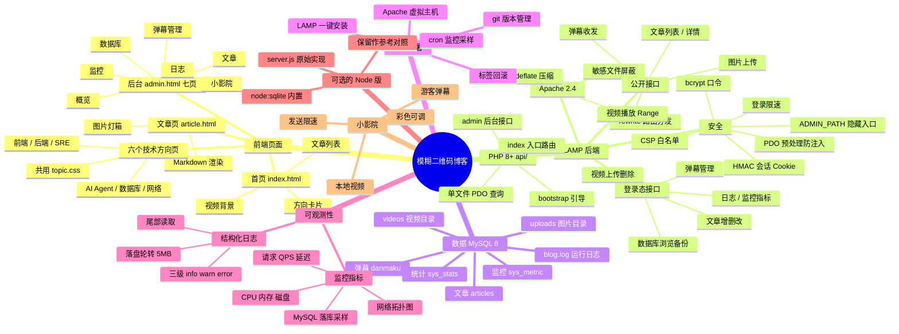

<div align="center">


<h1>模糊二维码 · blur-qr-blog</h1>

<p><strong>一个会动的、软乎乎的技术博客</strong> ヽ(✿ﾟ▽ﾟ)ノ</p>

<p>视频背景 ✦ 六个技术方向 ✦ 自己的小后台 ✦ LAMP 经典架构</p>

<p><code>Apache</code> ✧ <code>PHP 8+</code> ✧ <code>MySQL 8</code> ✧ <code>自托管</code></p>

</div>

---

## 这个仓库是什么呀，另一个在哪 (๑•̀ㅂ•́)و✧

这里是**服务器版**：Apache + PHP 8.2 + MySQL 8，也就是常说的 LAMP。
前端页面和另一个 Node 版本完全一样，只是后端换成了 PHP，数据进了 MySQL，
所以能放 K8s、能做定时备份、能在后台开终端。

| | 本仓库（Ubuntu 版） | [blur-qr-blog-Windows](https://github.com/ipc-mdd-gl3-1545/blur-qr-blog-Windows) |
| --- | --- | --- |
| 后端 | Apache 2.4 + PHP 8.2 + MySQL 8 | Node.js 22 + 内置 SQLite |
| 数据 | MySQL 库 `blog` | 本地 `data/blog.db` |
| 部署 | 一键脚本 / K8s 集群 | 解压双击、`npm start` |
| 运维 | 监控、日志、定时备份、SSH 控制台 | 只有本地日志与手动备份 |

> 两个仓库互相独立，**不是子模块**，clone 哪个都能单独跑。
> 只想在自己电脑上写文章、不想装环境 → 去 [Windows 版](https://github.com/ipc-mdd-gl3-1545/blur-qr-blog-Windows)；
> 想放到服务器上长期养着 → 就是这里，往下看 ٩(ˊᗜˋ*)و

> 完整架构图在 **[docs/ARCHITECTURE.md](docs/ARCHITECTURE.md)**，五层链路 + 39 项技术栈，一眼看完 (´｡• ᵕ •｡`)

---

## 这是什么呀 (｡･ω･｡)ﾉ♡

一个小小的个人博客星球，前面是粉紫色的玻璃感页面 + 会呼吸的视频背景，
后面是**自己写的 PHP 后端**（不是静态页面那种纸片人哦 (๑•̀ㅂ•́)و✧），
可以登进小后台写文章、传图片、发出去，数据乖乖躺在自己机器的 MySQL 里。

标准 LAMP 架构（Linux + Apache + MySQL + PHP），不依赖任何第三方框架，
装好 Apache / MySQL / PHP 就能跑～ 搬家用现成的虚拟主机也行，
适合放在自己的小服务器上养老 (´｡• ᵕ •｡`)

---

## 它都会做什么呀 ✧*｡

| 小家伙 | 会做的事 | 心情 |
| --- | --- | --- |
| 🎬 首页 | 全屏视频背景 + 打字机标题 + 呼吸感玻璃卡片 | 一眼就心动呀 |
| 🧭 六个方向 | 前端 / 后端 / SRE / AI Agent / 数据库 / 计算机网络，每个都是独立页面 | 学习路线 + 思维导图都画好了 |
| 📝 文章列表 | 卡片只留「封面 + 标题」，点一下就跳去正文页 | 清爽得像刚洗过脸 |
| 📖 文章详情 | 支持小标题 / 列表 / 引用 / 粗体 / 行内代码 / 图片，点图放大看 | Esc 就能关掉啦 |
| 🔐 小后台 | 登录、写文章、存草稿、传封面、看阅读数，左边导航分七页 | 只认我一个人 (๑>ᴗ<๑) |
| 🖼️ 图片上传 | 上传前在浏览器里先压一压（长边 1920），带百分比 + 速度进度条 | 大图也不卡啦 |
| 🎞️ 小影院 | 播放本机目录里的视频，自动生成播放列表 | 自己的片子自己排 |
| 💬 弹幕 | 游客也能发，彩色、透明度可调、网页全屏，带发送限速 | 像在看 B 站 (๑•̀ㅂ•́)و✧ |
| 🗄️ 数据库 | 后台里就能看表结构、翻数据、导出 CSV、下载整库快照、只读 SQL | 不用登服务器啦 (๑˃̵ᴗ˂̵)و |
| 📜 日志 | 登录、发布、上传、报错全记下来，能按级别和类别筛，能下载 | 出事了翻一翻就知道 |
| 📈 监控 | CPU / 内存 / 磁盘 / 请求数 / 响应耗时 / 事件循环，带趋势曲线 | 一眼看出哪里不舒服 |
| 📊 阅读数 | 每次打开正文悄悄 +1 | 有人来看就好开心 |
| 🚀 性能 | gzip、ETag/304、视频 Range 拖动、静态缓存 | 小机器也飞快 |
| 🛡️ 安全 | bcrypt 口令、HMAC 会话、登录限速、CSRF、CSP、源码与数据库全屏蔽 | 门锁好了才安心 |
| 🧰 运维 | Apache 自启、cron 采样、热备份脚本、清理未用图片、一键安装 | 懒人友好 ٩(ˊᗜˋ*)و |

---

## 小影院 & 弹幕 (｡･ω･｡)ﾉ♡

首页往下滑有个「小影院」，视频就放在这台机器的 `/var/www/blog/videos` 目录里，
由 Apache 直出、**秒开、随便拖进度条**，游客还能发弹幕 (๑˃̵ᴗ˂̵)و

一个配置就能开张：

```php
// api/config.php
'VIDEO_DIR' => '/var/www/blog/videos',   // 视频目录，换路径只改这一行
```

把 `mp4` 丢进去，`chown www-data:www-data`，刷新首页就有播放列表啦～

- **怎么传视频**：后台左侧导航点「🎞️ 小影院」，再点「上传视频」或直接把文件拖进去，
  带百分比和速度进度条；列表里能播放、能删除（删视频会顺手清掉它的弹幕）
- **为什么不用网盘**：试过 AList 接阿里云盘，第三方拉流只有 96 KB/s，而局域网是 20 MB/s 以上——差 200 倍，1080p 喂不动，所以干脆本地 (´･_･`)
- **只放这个目录**：`VIDEO_DIR` 之外的文件访问会被拒，`../` 穿越也会被拦掉
- **格式**：浏览器能直接播的是 `mp4`(H.264) 和 `webm`，`mkv`/`avi` 这类先转码
- **弹幕存在哪**：和文章同一个 MySQL，Indexed 查询，几万条也不慌 ╮(╯▽╰)╭
- **防刷屏**：同一 IP 默认 3 秒一条、单条最多 50 字（`DANMAKU_COOLDOWN_SEC` / `DANMAKU_MAX_LEN` 可调）

---

## 技术栈（标准 LAMP，朴素又耐造）

```
前端   原生 HTML + CSS + JavaScript（无构建、无框架、无 npm）
后端   PHP 8+  ·  PDO 操作 MySQL  ·  单入口路由（api/index.php）
Web    Apache 2.4（rewrite / deflate / headers 模块）
数据   MySQL 8（articles 文章 + danmaku 弹幕） + uploads/（图片）
视频   本机目录 /var/www/blog/videos（Apache Range，随便拖进度条）
部署   Apache + MySQL + cron 采样 + 一键安装脚本
```

> 小提示：这是标准 LAMP 架构，任何支持 PHP + MySQL 的主机都能跑——
> 虚拟机、云服务器、甚至共享虚拟主机都行，不用装 Node、不用跑常驻进程 (◍•ᴗ•◍)
>
> 仓库里还留着最初的 `server.js`（Node 版）作为参考，但**主推部署方式是 LAMP**。

---

## 想在自己服务器上跑跑看 (｡•̀ᴗ-)✧

```bash
# 1. 把项目克隆到网站根目录
sudo mkdir -p /var/www/blog
sudo git clone https://github.com/ipc-mdd-gl3-1545/blur-qr-blog-Ubuntu.git /var/www/blog
cd /var/www/blog

# 2. 一键安装（自动装 Apache/MySQL/PHP、建库、生成密码、配好 rewrite）
sudo bash deploy/lamp/install.sh
```

装完脚本会告诉你网址和**随机生成的后台密码**（只显示一次，记好！）。
首次请求会自动建表，什么都不用管～

后台地址不是 `/admin.html` 哦（那个被 Apache 拒绝访问 (｀・ω・´)），
而是 `api/config.php` 里 `ADMIN_PATH` 指定的路径，比如 `/manage`，
想改就同时改配置和 `apache-vhost.conf` 里的 rewrite 规则。

后台左边有七页：**概览 / 文章 / 小影院 / 弹幕 / 数据库 / 日志 / 监控**。

### 弹幕管理
游客发的弹幕后台全看得到：按视频分组，点开就能看时间、颜色、内容、来源，
支持搜索、单条删除、清空某个视频、或一键清空全部。视频删掉后残留的孤立弹幕也会列出来等你清理。

### 日志
登录、发布、改文、删文、传视频、改数据库、报错，都会按时间记一条，
分 info / warn / error 三级，带类别（request / auth / article / video / db / system）和来源 IP。

- **能筛**：只看「警告+」或只看「错误」，也能按类别挑、按关键词搜
- **能翻**：内存里滚动保留最近 1200 条（`LOG_BUFFER`），翻到更早有「加载更早」
- **能下载**：`data/blog.log` 是纯文本，一行一条，直接给出去也不怕看不懂
- **会轮转**：超过 `LOG_FILE_MB`（默认 5MB）就变成 `blog.log.1`，只留一份旧的，磁盘吃不垮
- **不进仓库、不外链**：`data/` 本来就被静态服务屏蔽，`.log` 后缀也在拒绝名单里

### 监控
每 10 秒采一个点，滚动保留最近 30 分钟（`METRIC_INTERVAL_SEC` / `METRIC_HISTORY` 可调）：

- **机器**：CPU 占用与 1/5/15 分钟负载、系统内存、进程 RSS 与堆、磁盘已用比例
- **业务**：请求总数、2xx/3xx/4xx/5xx 分布、平均与最慢响应、每秒请求数、最近 1 分钟请求量
- **健康**：事件循环延迟（>15ms 变黄，>50ms 变红，说明有东西堵住主线程了）
- **趋势**：CPU / 内存 / QPS 三条曲线，纯 SVG 画的，不引任何图表库
- **异常**：把日志里的 warn / error 摘出来放在最下面，不用来回切页

> 监控数据只存在内存里，服务重启就归零 —— 这不是 Prometheus，只是"够用"的程度 (๑•̀ㅂ•́)و✧

数据库页只是看看和备份用的，不让你在网页上乱写 SQL：

- **数据表**：`articles`、`danmaku` 各多少行多少列，一眼看完
- **浏览**：分页翻数据、按关键词搜、点表头换排序，长文本会截断（鼠标悬停看全文）
- **CSV**：单表导成带 BOM 的 csv，Excel 双击直接不乱码
- **下载数据库备份**：`VACUUM INTO` 生成的一致性快照，含 WAL 里还没合并的数据
- **压缩 / 合并 WAL / 清理孤立弹幕**：三个一键维护，都带确认弹窗
- **只读查询**：只放行 `SELECT` / `WITH` / `EXPLAIN`，最多 200 行，
  `DELETE`、`DROP`、多语句一律拦掉 (｀・ω・´)

---

## 部署到自己的小服务器 ♪(´▽｀)

把仓库内容放到 `/var/www/blog`，一行命令，脚本会把 Apache、MySQL、PHP、建库、密码、rewrite 全安排好：

```bash
cd /var/www/blog
sudo bash deploy/lamp/install.sh
```

装完会打印几行小纸条，记得抄下来：

```
网站地址   http://你的IP/
后台地址   http://你的IP/manage
后台密码   xxxxxxxx        # 随机生成，只显示这一次
数据库密码 xxxxxxxx        # 已写进 api/config.php
```

更多细节（Apache 配置、MySQL、证书、排错）都写在 **[DEPLOY.md](DEPLOY.md)** 里啦～

---

## 一张图看懂这个项目 (｡･ω･｡)ﾉ

下面这张思维导图把整个项目从头到尾理了一遍。GitHub 会自动渲染（不支持的编辑器就当代码块看）：



> 想改这张图，直接编辑上面的 `mindmap` 块即可；语法是 [Mermaid](https://mermaid.js.org/syntax/mindmap.html)。
> 项目里 `assets/mindmap.js` 是前台六个方向页用的另一套渲染器，跟这张说明图不是一回事。

---

## 新版前端怎么跑 (・∀・)

`web/` 是一套独立的前端工程：Vue 3 + Vite + TypeScript，构建时预渲染首屏 HTML，不需要在服务器上跑 Node。

```bash
cd web
npm install
npm run build      # 构建 + 预渲染，产物在 web/dist-web/
npm run typecheck  # 类型检查
npm run dev        # 本地开发
npm run preview    # 本地预览构建结果
```

- **多端适配**：viewport + 响应式 CSS + PWA manifest + service worker，手机/平板/桌面都能用。
- **埋点 SDK**：`web/src/analytics.ts` 上报到 `/api/track`，数据落在 MySQL 的 `track_events` 表，后台数据库页可直接查看。
- **CDN 预留**：复制 `web/.env.example` 为 `web/.env`，填 `VITE_CDN_BASE=https://你的CDN域名/`，重新构建即可；不填则同源加载。
- **部署提示**：把 `web/dist-web/` 里的文件复制到 Apache 文档根目录的 `web/` 子目录即可，原静态页面不受影响。

---

## 目录长这样 (・∀・)

```
.
├── index.html            # 首页：视频背景 + 方向卡片 + 文章列表
├── article.html          # 文章详情页（基础 Markdown 渲染 + 图片灯箱）
├── frontend.html         # 六个技术方向页，共用 assets/topic.css
├── backend.html
├── sre.html
├── ai-agent.html
├── database.html
├── network.html
├── admin.html            # 后台（只在 ADMIN_PATH 下由服务端返回）
├── api/                  # LAMP 后端（主推）
│   ├── bootstrap.php     # 配置/数据库/会话/日志/监控 引导
│   ├── index.php         # API 单入口路由
│   ├── admin.php         # 后台接口（登录后由 index 引入）
│   ├── manage.php        # 后台页面入口（ADMIN_PATH）
│   ├── sample.php        # cron 监控采样脚本
│   └── config.example.php# 配置样例（部署时复制为 config.php）
├── server.js             # 原始 Node 版后端（可选，保留作参考）
├── assets/               # 背景视频、海报、共享样式、思维导图渲染器
├── web/                  # 新版前端：Vue 3 + Vite + TypeScript
│   ├── src/              # 页面、路由、API 封装、埋点 SDK
│   ├── public/           # PWA manifest / service worker / CDN 缓存头样例
│   └── dist-web/         # 构建产物（不进仓库）
├── deploy/lamp/          # LAMP 部署：install.sh / apache-vhost.conf / init.sql
├── tools/                # 改密码、热备份、清理未用图片
├── videos/               # 小影院视频（不进仓库，路径由 VIDEO_DIR 指定）
├── data/blog.log         # 运行日志（不进仓库，超 5MB 轮转成 .1）
└── uploads/              # 上传的图片（不进仓库）
```

---

## 平时怎么照顾它呀 (๑˃̵ᴗ˂̵)

```bash
systemctl status apache2 mysql        # 看两个服务还好吗
tail -f /var/www/blog/data/blog.log   # 实时听它说话（Ctrl+C 退出）
systemctl restart apache2             # 改了 Apache 配置之后叫它重来
# 数据库备份：后台「数据库」页点「下载整库快照」，或在服务器执行：
mysql -u blog -p blog > blog-backup.sql
```

> Node 版的老工具（`tools/*.js`、`server.js`）仍留在仓库里作参考，
> LAMP 版用不上，忽略即可。

更新代码（服务器已经接过 Git 的话，PHP 改完立即生效，不用重启）：

```bash
cd /var/www/blog && git pull
```

---

## 留痕与回滚 (｡•́︿•̀｡)

每一件事一个提交，历史就是时间机器：

```bash
git add -A && git commit -m "feat: 加了个小功能"
git tag -a v1.1.0 -m "v1.1.0 小版本"      # 想记住这一刻
```

出问题了也不慌，三种姿势：

| 想做啥 | 命令 | 温柔程度 |
| --- | --- | --- |
| 只想看看旧版本 | `git checkout v1.0.0` | 看一眼，回来 `git checkout main` |
| 撤销某次改动 | `git revert <提交号>` | 最推荐，历史完整不心碎 |
| 本地改乱了 | `git reset --hard v1.0.0` | 有点狠，只在个人仓库用哦 |

服务器回滚：`cd /var/www/blog && git fetch --tags && git reset --hard v1.1.0`
（`api/config.php`、`data/`、`uploads/` 不在仓库里，怎么滚都不会丢 (๑•̀ㅂ•́)و✧）

仓库地址：<https://github.com/ipc-mdd-gl3-1545/blur-qr-blog-Ubuntu> ，每次改动都留在 `git log` 里。

---

## 一点点小提醒 ٩(๑•̀ω•́๑)۶

- `api/config.php` **别提交、别截图、别发群**，里面是数据库密码和会话密钥（仓库里已经忽略了）
- 后台上传只接受 PNG / JPG / GIF / WebP，单张 5MB 以内，会检查文件头，伪装的可骗不过它
- 想做公网访问，建议放云服务器；家宽直接开端口，容易半夜被扫 (｡•́︿•̀｡)
- 数据都在 MySQL 里，**备份比什么都重要**：后台「数据库」页能下载整库 SQL 快照，
  或者加个 crontab 每天凌晨跑 `mysqldump -u blog -p blog > /backup/blog-\$(date +\%F).sql` 就好啦

---

<div align="center">

**谢谢你来这个小星球转一圈** (´｡• ᵕ •｡`)

如果它让你心情变好了一点点，就给它一颗 ⭐ 吧 ✧*｡

<sub>Made with 粉紫色、可乐和很多很多耐心</sub>

</div>
