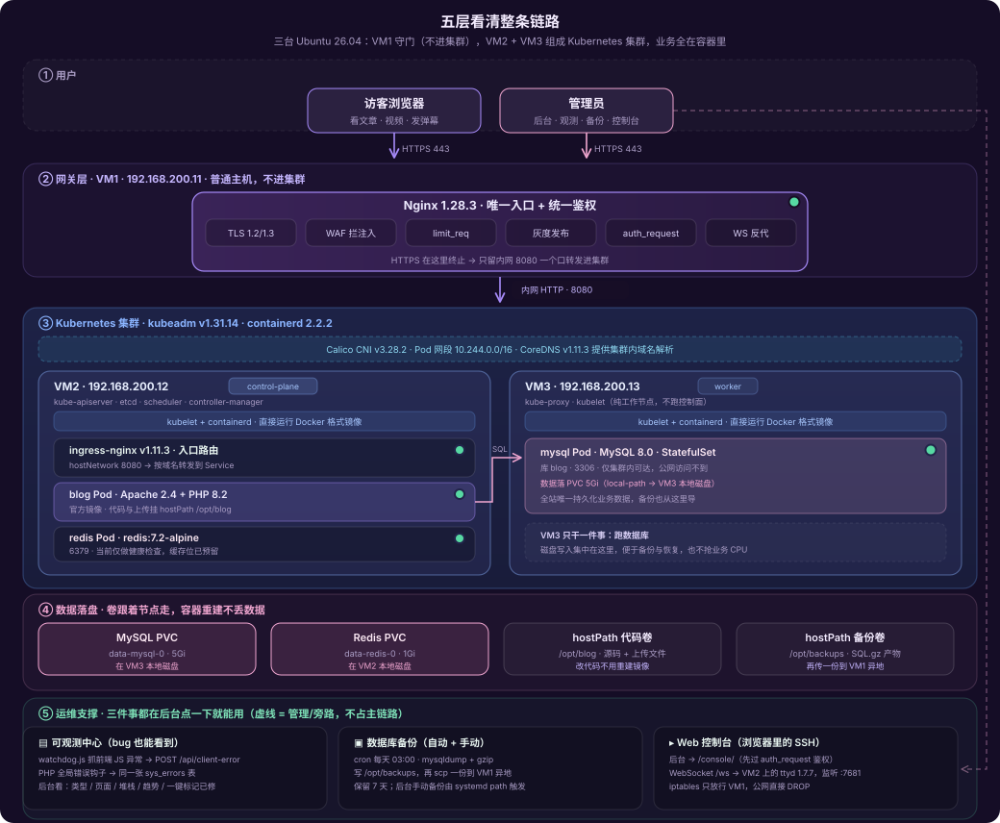

<div align="center">


</div>

# 后端架构图 · 五层看完这条链路 (๑•̀ㅂ•́)و✧

> 三台 Ubuntu 26.04 虚拟机：**VM1 守门**，**VM2 + VM3 组 Kubernetes**，业务全在容器里跑。
> 图是矢量 SVG，点开放大也不糊；后台「架构图」页里是同一份，改一处要记得同步另一处哦 (´･ω･`)



<sub>如果你的 Markdown 客户端不肯显示 SVG（有些会），往下看文字版，一样能看懂～</sub>

---

## 30 秒版 ヽ(✿ﾟ▽ﾟ)ノ

```
访客 ──HTTPS──▶ VM1 Nginx ──内网 8080──▶ K8S Ingress ──▶ blog 容器 ──▶ MySQL
                  │                                        └──▶ Redis
                  └── 旁边还挂着三条旁路：可观测 / 备份 / Web 控制台
```

一句话：**外面只露一个 443 的门，门后全是内网；数据库连公网的门都没有。**

---

## 五层拆开看

### ① 用户层 · 谁在敲门 (｡･ω･｡)ﾉ♡

| 角色 | 从哪进来 | 来干嘛 |
| --- | --- | --- |
| 访客 | `https://192.168.200.11/` | 看文章、看小影院、发弹幕 |
| 管理员 | 同一域名 + 隐藏路径 `/manage` | 写文章、看观测、点备份、开控制台 |

后台入口**不出现在首页任何地方**，只有知道路径的人才能打开登录页 (๑>ᴗ<๑)

### ② 网关层 · VM1 · 不进集群 ( • ̀ω•́ )✧

普通主机，跑 **Nginx 1.28.3**，是整条链路唯一的入口：

| 能力 | 实现 | 为什么要有 |
| --- | --- | --- |
| TLS 终止 | 自签证书，TLS 1.2/1.3 | 内网只跑 HTTP，省掉集群里配证书的麻烦 |
| WAF | 手写 `location` 规则 | SQL 注入、`../` 穿越这类请求直接 403 |
| 限流 | `limit_req` | 登录、发弹幕、上传各一档，防刷 |
| 灰度 | `map` + `split_clients` | 按比例把流量切到新版本 |
| 统一鉴权 | `auth_request` → `/api/authz`（internal） | 后台、`/console/`、`/ws` 共用一套登录态 |
| WebSocket 反代 | `proxy_http_version 1.1` + `Upgrade` | 控制台要长连接，不转就 400 |
| 防火墙 | `ufw` | 只留 22 / 80 / 443 |

> 小提醒：网关**必须透传真实 Host**（`proxy_set_header Host $host`），
> 一旦改写成固定域名，后台的同源校验就会把正常请求当成跨站，直接 403 (｡•́︿•̀｡)

### ③ 集群层 · VM2 + VM3

| 节点 | 角色 | 上面跑了什么 |
| --- | --- | --- |
| VM2 `192.168.200.12` | control-plane + 干活 | kube-apiserver / etcd / scheduler / controller-manager、ingress-nginx、blog Pod、redis Pod |
| VM3 `192.168.200.13` | worker，专心跑数据 | kube-proxy / kubelet、mysql Pod（StatefulSet） |

| 组件 | 版本 | 干的活 |
| --- | --- | --- |
| Kubernetes | v1.31.14 | 编排、调度、自愈 |
| containerd | 2.2.2 | 真正跑容器的运行时（能直接跑 Docker 格式镜像） |
| Calico CNI | v3.28.2 | Pod 网段 `10.244.0.0/16` 跨节点互通 |
| CoreDNS | v1.11.3 | 集群内域名解析，`blog`、`mysql` 这些名字靠它 |
| ingress-nginx | v1.11.3 | `hostNetwork` 监听 8080，按域名转 Service |
| local-path-provisioner | v0.0.28 | 动态建 PV，卷落在 Pod 所在节点的磁盘上 |

请求在集群里这样走：

```
VM1 ──8080──▶ ingress-nginx（catch-all，不写 host）
                   │  按 path 转 Service
                   ▼
              Service blog:80 ──▶ blog Pod（Apache 2.4 + PHP 8.2）
                                        │
                                        ├──▶ Service mysql:3306 ──▶ mysql Pod
                                        └──▶ Service redis:6379 ──▶ redis Pod
```

> 为什么 Ingress 不写 host？因为 K8s 的 `host` 字段**只认域名、不认 IP**，
> 写 `192.168.200.11` 会报 `must be a DNS name`。所以用一条不写 host 的 catch-all 兜住，
> 顺手也就支持了「IP 直接访问」(๑˃̵ᴗ˂̵)و

### ④ 存储层 · 数据睡在哪 (´｡• ᵕ •｡`)

| 卷 | 类型 | 容量 | 位置 | 放什么 |
| --- | --- | --- | --- | --- |
| `data-mysql-0` | PVC | 5Gi | VM3 本地盘 | 全站唯一持久化的业务数据 |
| `data-redis-0` | PVC | 1Gi | VM2 本地盘 | 缓存位（目前只探活） |
| `/opt/blog` | hostPath | 随盘 | VM2 | 源码 + 上传的图片视频 + 后台配置 |
| `/opt/backups` | hostPath | 随盘 | VM2 | 每日导出的 `*.sql.gz` |

代码走 hostPath 是有意的：**改完文件立即生效，不用重建镜像**，
容器怎么重建都不会把文章和图片弄丢 (๑•̀ㅂ•́)و✧

### ⑤ 运维支撑 · 三条旁路

这三条**不参与用户请求**，但出事时全靠它们兜底，所以在图上单独画一块：

| 旁路 | 链路 | 触发方式 | 产物 |
| --- | --- | --- | --- |
| 🔍 可观测 | `watchdog.js` → `POST /api/client-error` → `sys_errors`；PHP 全局错误钩子也写同一张表 | 用户一访问就自动跑 | 后台「观测中心」：类型 / 页面 / 堆栈 / 趋势 / 标记已修 |
| 💾 备份 | `mysqldump` + `gzip` → `/opt/backups` → `scp` 一份到 VM1 | cron 每天 03:00；后台按钮走 systemd `.path` 单元 | `blog_YYYYMMDD_HHMMSS.sql.gz`，保留 7 天，可下载 / 恢复演练 |
| 🖥️ 控制台 | 后台 → `/console/`（`auth_request` 先拦一道）→ WebSocket `/ws` → `ttyd 1.7.7:7681` | 点开就进 | 浏览器里的终端，`iptables` 只放行 VM1，公网直接 DROP |

> 监控不是 Prometheus，是「够用版」：前端 JS 报错 + PHP 报错都收进一张表，
> 后台能直接看到**是哪个页面、哪一行、什么错**——连 bug 都能看到的那种 ( • ̀ω•́ )✧

---

## 技术栈 39 项 · 按层数一遍

| 分组 | 技术 |
| --- | --- |
| **网关入口（8）** | Nginx 1.28.3 · OpenSSL 自签 TLS · 手写 WAF · `limit_req` 限流 · `auth_request` 鉴权 · `map` 灰度 · WebSocket 反代 · ufw |
| **容器编排（9）** | Kubernetes v1.31.14 · kubeadm · kubelet · containerd 2.2.2 · Calico v3.28.2 · CoreDNS v1.11.3 · ingress-nginx v1.11.3 · Deployment / StatefulSet · ConfigMap |
| **数据存储（5）** | MySQL 8.0 · Redis 7.2-alpine · local-path-provisioner v0.0.28 · PVC / PV（5Gi + 1Gi）· hostPath |
| **应用运行（6）** | Apache 2.4 · PHP 8.2 · 原生 PHP API（无框架）· Markdown 渲染 · bcrypt · PDO 预处理 |
| **运维工具（8）** | systemd（服务 / path 单元）· cron · mysqldump + gzip · scp · ttyd 1.7.7 · iptables · `sys_errors` · `watchdog.js` |
| **系统底座（3）** | Ubuntu 26.04.1 LTS ×3 · VMware 虚拟机 · Pod 网段 `10.244.0.0/16` |

> Redis 目前**只被 `/healthz` 做端口探活**，业务还没用上缓存，图上标的是「缓存位已预留」，
> 不是「正在缓存」——不吹牛 (´･ω･`)

---

## 端口 / 路径速查

| 项目 | 值 | 说明 |
| --- | --- | --- |
| 对外入口 | `https://192.168.200.11/`（443） | 只有这一个门 |
| 后台 | `/manage`（见 `/opt/blog/api/config.php` 的 `ADMIN_PATH`） | 不在首页出现 |
| 集群入口 | VM2:8080（ingress `hostNetwork`） | 只在内网，VM1 才能连 |
| MySQL | `mysql:3306`（集群内） | 公网不可达 |
| Redis | `redis:6379`（集群内） | 公网不可达 |
| 控制台端口 | VM2:7681（ttyd） | `iptables` 白名单只放 VM1 |
| 代码 / 上传 | `/opt/blog` | hostPath 挂进 blog Pod |
| 备份产物 | `/opt/backups/mysql` | 另有副本在 VM1 |
| 日志 | `journalctl -u nginx` / `kubectl logs` / 后台「日志」页 | 三处都能查 |

---

## Node 单机版差在哪？(・∀・)

姊妹仓库 [blur-qr-blog-Windows](https://github.com/ipc-mdd-gl3-1545/blur-qr-blog-Windows) 那套是「一个人玩」的形态，架构图上除了 ② 之外都可以不看：

| | 单机版 | 集群版 |
| --- | --- | --- |
| 进程 | 一个 `node server.js` | Apache + PHP 容器，K8S 调度 |
| 数据 | `data/blog.db`（SQLite） | MySQL 8（独立 Pod + PVC） |
| 静态资源 | Node 自己发 | Apache 直出 |
| 部署 | `npm start`，Windows 双击也行 | `deploy/lamp/install.sh` 或 K8S 清单 |
| 备份 | `tools/backup.js` 拷 `.db` | `mysqldump` + 异地 `scp` |

> 两套的**前端页面是同一份**（各存一份副本，方便各自打包带走）。
> 改了页面记得两边一起改，不然会出现「本地好好的，服务器上还是旧文案」这种灵异事件 (｡•́︿•̀｡)

---

## 踩坑备忘 · 都是真踩过的

1. **IP 访问 404**：网关把 Host 改写成 `blog.local`，Ingress 匹配不到 → 透传真实 Host + catch-all。
2. **透传 Host 后 403**：后台的同源校验比对 `Origin` 和 `Host`，改写就废 → 见第 1 条的正解。
3. **上传视频 413**：Nginx、Ingress、PHP 三层默认分别是 1M / 1M / 8M，三层都要抬到 1024M。
4. **弹幕发一条显示两条**：手动 `spawn` 后轮询又 `spawn` 一次 → 用弹幕 `id` 去重。
5. **`sys_errors` 表不存在**：`dbInit()` 看到 marker 就跳过 → 单独 `ensureErrorTable()` + 新 marker。
6. **备份报 `using password: NO`**：`MYSQL_PWD` 设在宿主机，没进容器 → `kubectl exec ... env MYSQL_PWD=... mysqldump`。
7. **systemd 不认 `PathCreated`**：老版本没这个指令 → 改用 `PathExists`。
8. **控制台 502 / 页面 173 字节**：ttyd 只绑了 `127.0.0.1`，且 `-b` 前缀和网关重写打架 → 绑 VM2 的 IP，去掉 `-b`，网关单独放行 `/ws`。
9. **备份列表是空的**：`/opt/backups/mysql` 是 700，PHP 进程读不到 → `chmod 755` 并固化进 worker 脚本。
10. **SVG 注释写 `<!-- ---- 分节 ---- -->`**：XML 里连续 `--` 非法，整张图渲染不出来 → 注释里别用连字符分隔线。

---

## 想自己复查一遍？

```bash
# 集群里现在跑着什么
kubectl get pods -A -o wide

# 入口是否活着
curl -kI https://192.168.200.11/healthz

# 最近一次备份
ls -lh /opt/backups/mysql | tail -3

# 后台看到的错误，命令行也能看
kubectl exec mysql-0 -- mysql -uroot -p"$MYSQL_ROOT_PASSWORD" blog \
  -e "SELECT t,source,level,kind,LEFT(message,60) FROM sys_errors ORDER BY id DESC LIMIT 10"
```

看完这张图，再回头看后台那个「架构图」页，应该就是熟人见面了 ٩(ˊᗜˋ*)و
